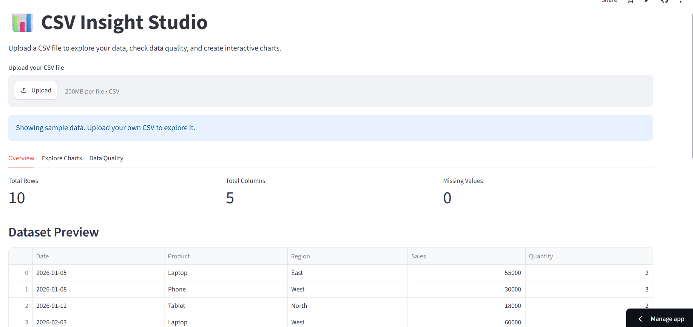
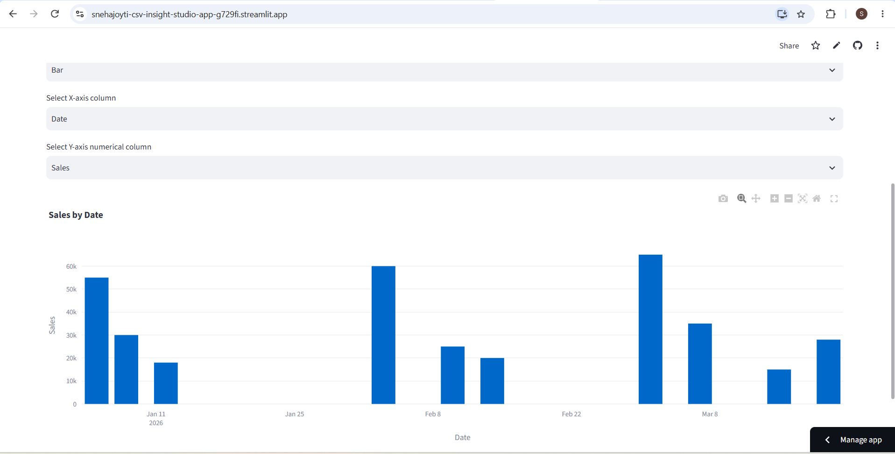
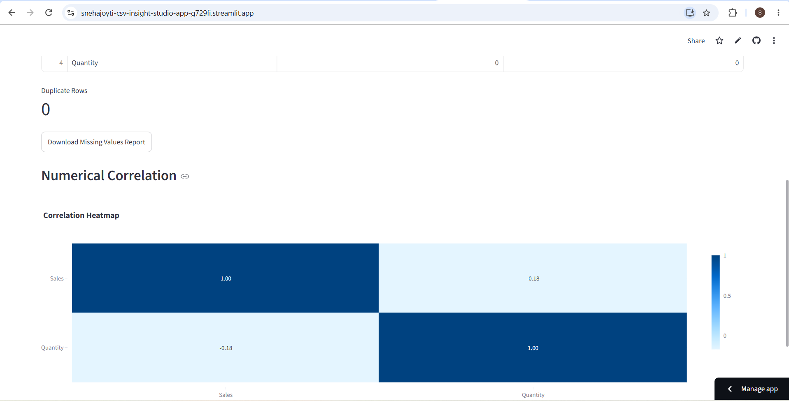

# CSV-Insight-Studio

An interactive Streamlit dashboard for exploring CSV datasets, analyzing data, visualizing trends with Plotly charts, and identifying data quality issues such as missing values and duplicates.

Built with Python, Pandas, Streamlit, and Plotly.

## Live Demo

Try the app: https://snehajoyti-csv-insight-studio-app-g729fi.streamlit.app/







## Features

- Upload and explore CSV files
- View dataset dimensions and preview data
- Generate summary statistics
- Create interactive charts
- Identify missing values and duplicate rows
- Download a missing-values report

## Run Locally

1. Clone this repository:

   ```bash
   git clone https://github.com/snehajoyti/CSV-Insight-Studio.git
   cd CSV-Insight-Studio


   
